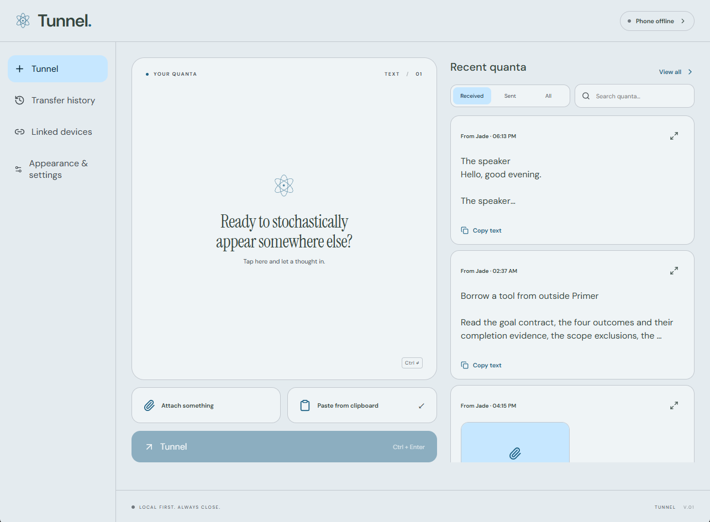
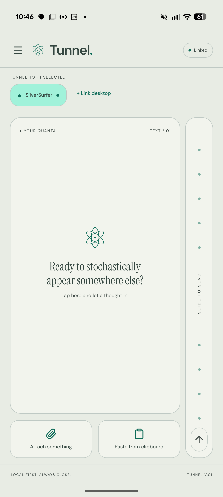

# Tunnel

Send text, links, images, and files between an Android phone and linked desktops over a local network. Tunnel is for people who move small pieces of work between devices: a URL from a phone to a PC, a screenshot with a note, or a document sent back to the phone. It provides a dedicated alternative to sending those items to yourself through a messaging or cloud account.

**Status:** version 0.1.0, a development build focused on Windows and Android. Local builds are the current workflow; installers and distribution bundles are disabled. A macOS build workflow exists in local development but remains uncommitted and unverified; iOS is also unverified. See [limitations](#status-and-limitations) before relying on it.

**Published-code boundary:** multi-desktop routing and the cross-platform desktop command dispatcher are implemented locally but are not included in this documentation-only commit. Their descriptions below are marked as local development; a fresh checkout retains single-desktop phone pairing and Windows root build commands.

[Get started](#run-locally) · [Usage guide](docs/usage.md) · [Architecture](#how-it-is-built) · [Checks](#tests-and-build-checks) · [Current verification](continuity/status.md)

## Screenshots

User-provided screenshots of the native desktop and Android apps. They show local builds; screenshots are not a substitute for the pending device checks.



*Desktop composer and recent history in Tide light mode. The phone is offline in this capture.*



*Android composer in Mineral light mode, with one destination selected and the send rail on the right. The destination selector reflects local multi-desktop work described below.*

## What you can do

The UI calls a transfer a **quanta**: text, attachments, or both.

| Feature | Example |
| --- | --- |
| Send in either direction | Paste a phone URL into a desktop workflow, or send a PDF from the desktop to Android. |
| Attach files with an optional note | Send screenshots and “Review the highlighted section” together. Native transfers accept up to 32 files and 250 MiB combined; text is limited to 64 KiB of UTF-8. |
| Choose multiple desktops (local development) | Link up to eight desktops to one phone, then select one or more destinations. Each desktop pairs with one phone. |
| Share from other Android apps | Use the share sheet or selected-text **Tunnel** action. Text defaults to background sending; images and other files default to review in the composer. These settings are configurable by type. |
| Track delivery and retry | Search the latest 200 history entries by note or filename. Retry an unconfirmed recipient using the original transfer ID; partial success keeps the draft. |
| Keep Tunnel close at hand | Windows tray operation, optional launch at login, **Ctrl+Shift+Space** to open, and **Ctrl+Enter** to send. Android uses a foreground connection service. |
| Customize the interface | Mineral, Dune, and Tide themes with light/dark/system appearance; Android supports Left, Right, or Under send-rail placement and an Under button option. |

Incoming text and single images copy to the Windows clipboard by default. Android auto-copy applies to text while the UI is active. Auto-copy can be disabled. Desktop attachments offer Copy/Save; Android offers an image viewer and Save/Share actions.

## Run locally

### Prerequisites

- **Node.js 24 LTS and npm**, using the root lockfile and npm workspaces.
- **Windows desktop:** Rust with the MSVC toolchain, Visual Studio C++ build tools, and WebView2. The helper can use an ignored portable Rust installation under `.tools/`, but a fresh checkout needs its own toolchain.
- **Android:** Android Studio SDK/platform/build tools compatible with the checked-in Expo 57 project, a suitable JDK (the helper tries Android Studio's bundled runtime), and Android 9/API 28 or newer. Native run/install commands require a USB-debugging device or an emulator you have started. **Expo Go cannot run the custom native sharing/connection module.**
- **macOS desktop:** Node/npm, Rust, and Xcode command-line tools. See [Tauri prerequisites](https://v2.tauri.app/start/prerequisites/). Compilation and runtime still need verification on a Mac.

Run all commands from the repository root. No account, API key, hosted backend, or `.env` file is required. Pairing credentials are generated at runtime.

### Install and start the desktop

```powershell
# From your local tunnel checkout
npm ci
npm run desktop                  # Native Tauri app with hot reload
```

For a standalone Windows executable:

```powershell
npm run build                    # Tauri release with embedded frontend; no installer
.\target\release\tunnel-desktop.exe
```

Use the npm build command: a release guard rejects direct Cargo builds without Tauri's embedded-asset configuration. If rebuilding fails because the executable is in use, choose **Quit** from the tray; closing the window only hides it.

In the uncommitted macOS workflow, `npm ci`, `npm run desktop`, and `npm run build` use a cross-platform dispatcher and produce `./target/release/tunnel-desktop`. These root commands are still Windows-specific in the published code; the Mac workflow requires the local dispatcher changes and has not been compiled or exercised on a Mac.

### Install and start Android

The root Android helpers use PowerShell on Windows. They honor `JAVA_HOME` and `ANDROID_HOME` (or `ANDROID_SDK_ROOT`), then try standard Android Studio locations. Only set overrides when needed, using paths that exist on your machine:

```powershell
# Optional local toolchain overrides; these are paths, not credentials.
$env:JAVA_HOME = 'C:\Program Files\Android\Android Studio\jbr'
$env:ANDROID_HOME = "$env:LOCALAPPDATA\Android\Sdk"
```

```powershell
npm run android                  # Build/install development app and start Metro
npm run mobile                   # Metro alone for an installed development build

# Alternative: build/install with embedded JavaScript, runnable without Metro
npm run build:android
```

Choose the development or standalone workflow as appropriate; both native run commands install to a device/emulator. The standalone Android build uses development signing, not a distribution signing setup. Rebuild it to include subsequent JavaScript changes. See [setup and troubleshooting](continuity/developer/setup.md) for details.

### Pair and send

1. Put both devices on the same reachable private IPv4 LAN/Wi-Fi network.
2. On the desktop, open **Linked devices** and create a pairing QR. Select the Wi-Fi/LAN address the phone can reach if multiple adapters appear.
3. On Android, scan it from **Linked devices**. Codes expire after five minutes. Alternatively, use **Copy pairing code** on the desktop and paste its JSON into Android's pairing form. Treat that code as a credential.
4. Enter a harmless example such as `Review the draft on my desktop`, or attach a synthetic file. On desktop, press **Tunnel** or **Ctrl+Enter**. On Android, flick the send rail upward or use the configured button.
5. **Local development only:** to add another desktop, choose **Link another desktop** on Android and repeat pairing. Select destination chips above the composer before sending.

The desktop listens on **TCP 53177**. Allow private-network firewall access when prompted. Guest Wi-Fi isolation, VPN routing, sleep, and changed IP addresses can prevent connections. Internet/cellular transfer and automatic rediscovery after an address change are not implemented.

**Local multi-desktop behavior:** an unchanged draft clears after every selected desktop confirms. For partial delivery, retry only the failed recipient entries in history. Manually composed offline transfers remain drafts; instant Android shares queue per original recipient and send on reconnection. A timeout means receipt is unconfirmed; it does not prove that nothing arrived.

### Browser preview

```powershell
npm run dev
# Open http://127.0.0.1:1427
```

This is the desktop frontend preview, with no native pairing, transport, tray, or attachment operations. It can demonstrate the composer and appearance settings with synthetic text, without a phone or account. A narrow browser viewport is not the native Android UI.

## How it is built

| Component | Technology and responsibility |
| --- | --- |
| [Desktop UI](apps/desktop/src) | React 19, TypeScript, Vite, and Tauri 2 IPC for the composer, pairing, history, and settings. |
| [Desktop runtime](apps/desktop/src-tauri/src) | Rust, Tokio, and WebSockets; owns the LAN listener, persistence, clipboard, tray, notifications, and shortcuts independently of the WebView. No Node server is needed in the built app. |
| [Mobile UI](apps/mobile/src) | React Native and Expo 57 for the composer, camera pairing, gesture/haptic feedback, and attachment import/export. |
| [Android native module](apps/mobile/modules/tunnel-link) | Kotlin foreground service and independent peer sessions keep connections and instant sharing outside the React UI lifecycle. |
| [Shared contract](packages/shared/src) | TypeScript protocol validation, crypto/client logic, recipient routing, composer helpers, and theme preferences. |
| [Aurora snapshot](vendor/aurora) | Vendored core plus web/native adapters. One shared core instance and a stable theme contract keep platform theming consistent. Provenance and licenses are retained with the snapshot. |

Pairing transfers a shared key, expiring token, desktop identity, and LAN endpoint by QR/manual code. An encrypted handshake binds the phone identity. Application messages use **ChaCha20-Poly1305** with random 96-bit nonces over WebSockets. Unlinking a desktop rotates its key and closes its connection.

Native attachment paths stream authenticated **48 KiB chunks** to disk rather than assembling entire transfers in memory. Receipts follow persistence; duplicate IDs are retained separately from visible history to avoid repeated receipt side effects. The local multi-desktop implementation uses separate keys, connections, and recipient-specific transfer IDs, allowing a failed recipient to be retried independently. The non-Android JavaScript fallback still assembles bytes in memory and is limited to 5 MiB.

Desktop keys and history are readable by the local user in the app data directory; app-level encryption at rest is not included. Android pairing credentials use SecureStore and a Keystore-protected native copy; UI drafts/history use AsyncStorage. Received attachments are stored privately before export. Tunnel has no analytics, cloud storage, or account requirement. See [architecture](continuity/developer/architecture.md) and [data model](continuity/data/model.md) for protocol and storage details.

## Tests and build checks

Install dependencies first. These commands do not launch the application or install it on a device:

```powershell
npm test                         # Vitest: protocol, attachments, themes, composer, routing
npm run typecheck                # Desktop and mobile TypeScript
npm run test:rust                # Rust protocol, crypto fixtures, attachment streaming
npm run build:web                # Typecheck and Vite production build; not a native app
npm run build:android:bundle     # Android JS/Hermes export; not a native APK
```

The [Android JVM crypto tests](apps/mobile/modules/tunnel-link/android/src/test/java/app/tunnel/link/LinkCryptoTest.kt) cover native interoperability. See [current verification](continuity/status.md#last-verified-state) for dated results and [historical verification](docs/verification.md) for earlier evidence and dependency-review notes.

`npm run test:ui` runs Playwright against the browser preview using installed Google Chrome; selected tests mock Tauri IPC and do **not** establish native delivery. It includes preview screenshot capture. The separate [native smoke workflow](tests/native-smoke.mjs) drives desktop and Android and changes clipboard/device state. Project instructions require explicit permission before UI/device automation; neither workflow is part of the default checks above.

**Documentation refresh, 2026-10-14:** `npm test` (30 tests), `npm run typecheck`, `npm run test:rust` (8 tests), `npm run build:web`, and `npm run build:android:bundle` passed against the existing installed dependencies. The browser preview was launched for the original approved screenshots; those images were subsequently replaced with the user-provided native screenshots above. `npm ci`, native release builds/install commands, JVM tests, and the full UI/native smoke suites were not rerun. Source inspection of setup helpers is distinct from a fresh-install or device test.

## Status and limitations

- Windows and Android native builds have prior successful build evidence; current device/visual checks remain pending. macOS compilation/runtime and iOS behavior are unverified. macOS notification-click activation needs its own implementation.
- Local phone-to-desktop routing is published. Phone-to-multiple-desktop routing is implemented in the uncommitted working tree. Accounts, remote relay, cellular transfer, automatic address discovery, desktop-to-desktop, and phone-to-phone routing are unfinished.
- In-app recording, OCR, continuous clipboard monitoring, resumable transfers, and transfer-progress UI are not implemented. Audio can be sent as a file.
- Android controls service lifetime, force-stop/battery restrictions, share-menu placement, and Direct Share ranking. Receipt notification permissions must be granted; phone clipboard copying requires the active UI.
- Native peers must be updated together for the current chunked file protocol. Interrupted imports can leave unreferenced local files; no secure-erasure guarantee is made.
- Existing dependency-review notes record inherited Expo/React Native build-chain advisories. That historical audit is not a fresh security assessment; review dependencies before distribution.

## Further documentation

- [Detailed usage and engineering notes](docs/usage.md): clipboard behavior, gestures, media saving, retry semantics, and Aurora provenance.
- [Developer setup](continuity/developer/setup.md): toolchains, native workflows, and troubleshooting.
- [Current status and pending human checks](continuity/status.md): known verification gaps, including multi-desktop and Mac checks.
- [Implementation map](continuity/agent/map.md): source routes for contributors; [Continuity overview](continuity/README.md) explains the documentation structure.
- [Roadmap](continuity/planning/roadmap.md) and [network proposals](continuity/planning/network-transfers.md): selected local work and future proposals, distinguished from implemented features.
